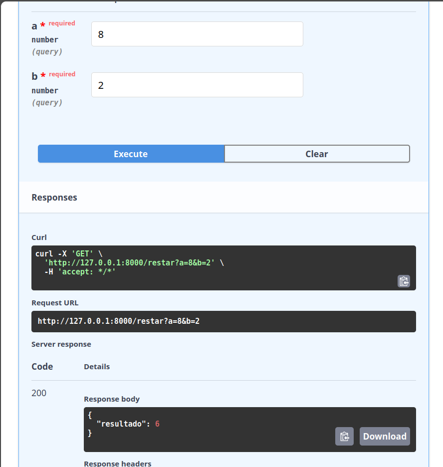
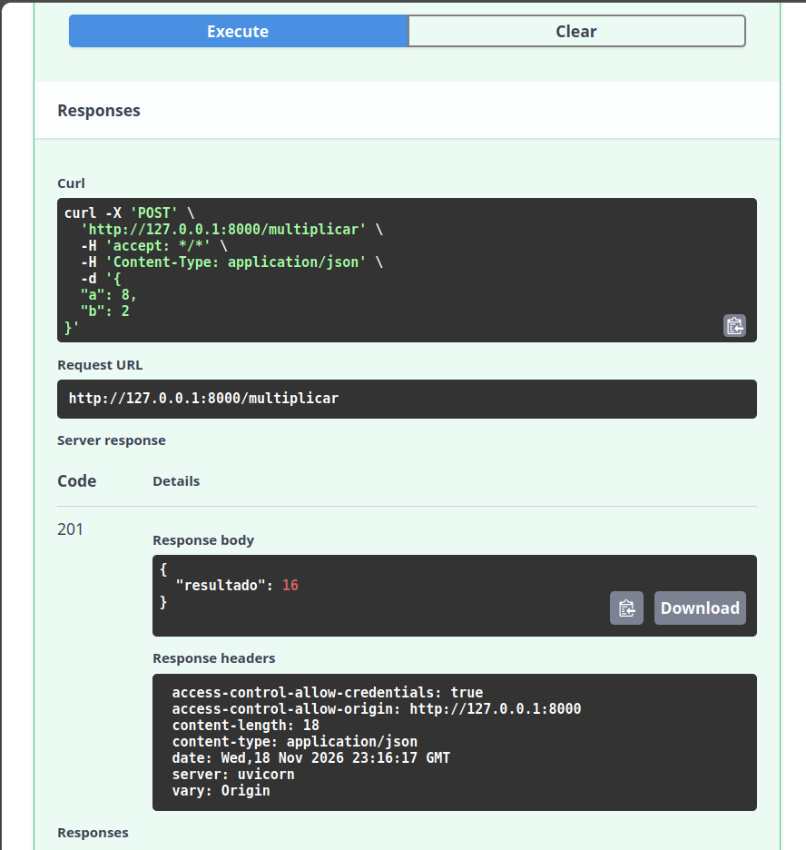
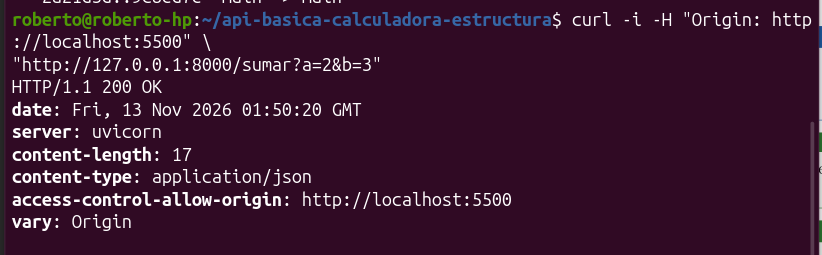

# API basica: calculadora y estructura
Practica de Programacion Web con Python y FastAPI.
## Requisitos
Python 3.10 o superior
## Instalacion
python3 -m venv .venv
source .venv/bin/activate
pip install -r requirements.txt
## Ejecucion
uvicorn main:app --reload
## Documentacion
http://127.0.0.1:8000/docs

## Capturas de comunicacion Frontend - Backend

**Resta (8 - 2):**

**Multiplicacion (8 * 2):**

**Division (8 / 2):**

**Division entre cero (Error HTTP 400):**

### Prueba Paso 5.2 (CORS - Simulando frontend externo)

### Prueba Paso 7.1 (Validacion de DTO de entrada)

