# API basica: calculadora y estructura
Practica de Programacion Web con Python y FastAPI.
## Requisitos
Python 3.10 o superior
## Instalacion
python3 -m venv .venv
source .venv/bin/activate
pip install -r requirements.txt
## Ejecucion
uvicorn main:app --reload
## Documentacion
http://127.0.0.1:8000/docs

## Capturas de comunicacion Frontend - Backend

**Resta (8 - 2):**

**Multiplicacion (8 * 2):**

**Division (8 / 2):**
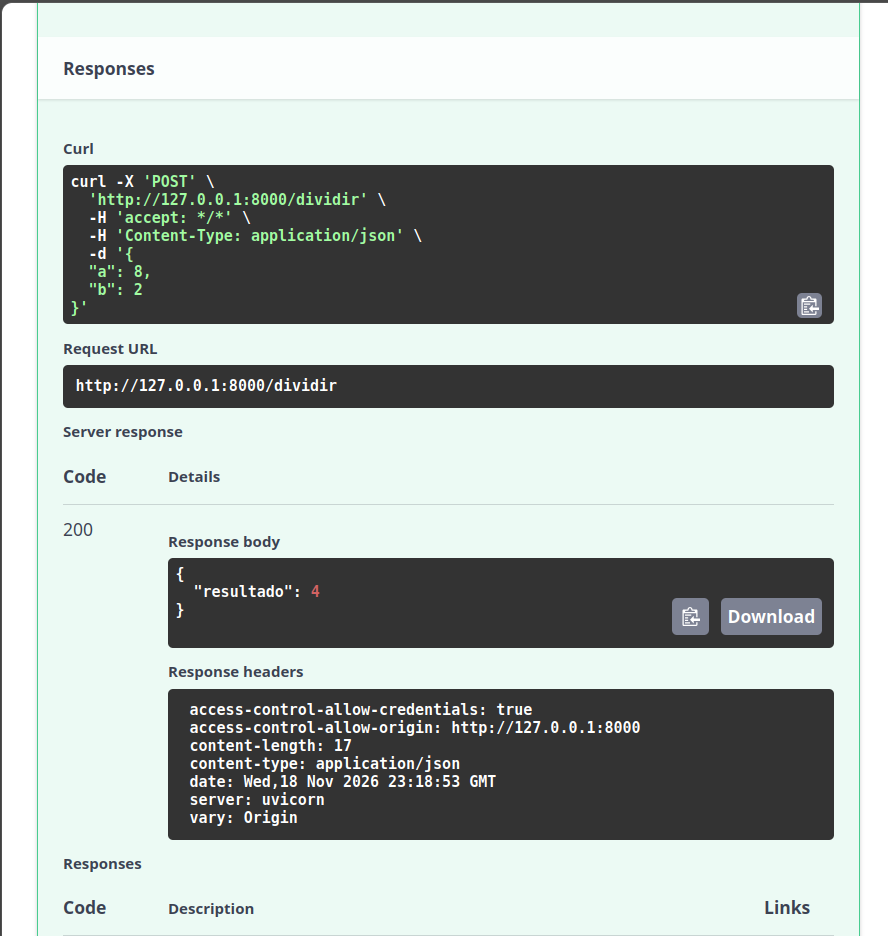

**Division entre cero (Error HTTP 400):**

### Prueba Paso 5.2 (CORS - Simulando frontend externo)

### Prueba Paso 7.1 (Validacion de DTO de entrada)
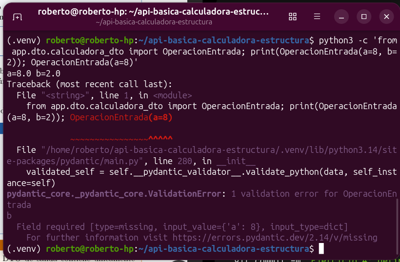

### Prueba Paso 8.2 (Logica de negocio en capa de servicio)
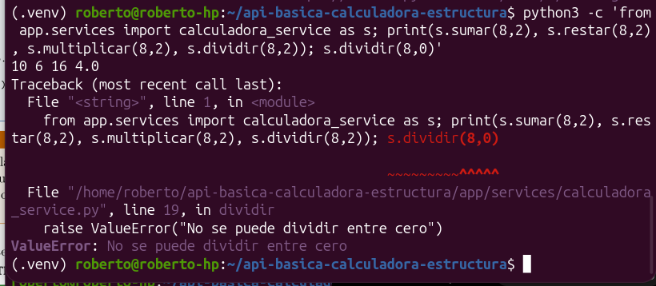

### Prueba Paso 8.2 (Capa de servicio en interprete Python)
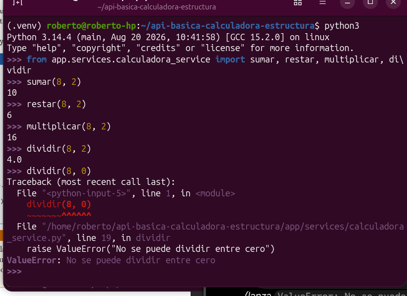

### Prueba Paso 9.1 (Controlador, rutas HTTP y error 400)
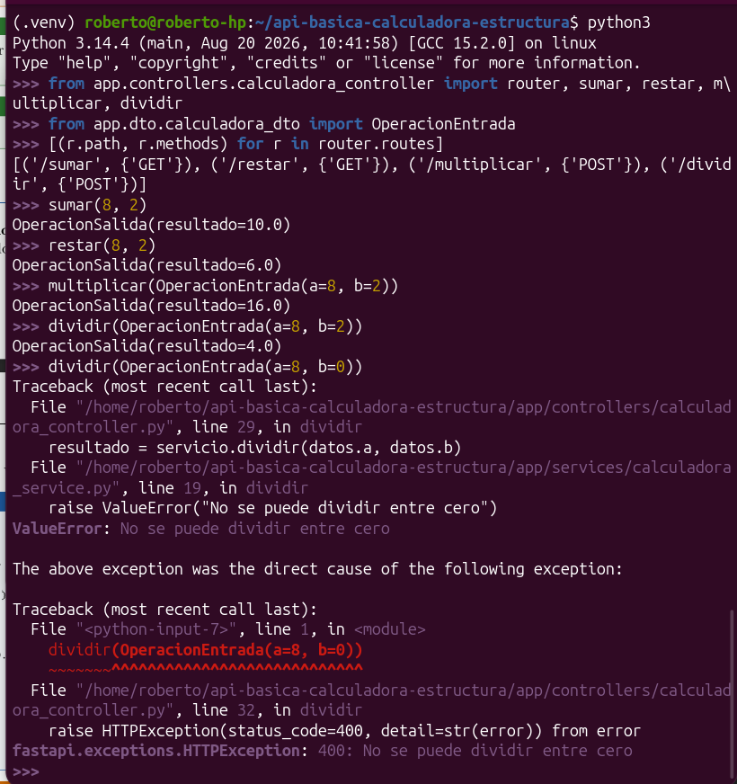

## Estructura
etapa_1/main.py: version inicial
main.py: inicio de la version estructurada
app/controllers/: rutas HTTP
app/dto/: datos de entrada y salida
app/services/: operaciones matematicas

## Ejemplos de uso
GET /sumar?a=8&b=2
GET /restar?a=8&b=2
POST /multiplicar {"a": 8, "b": 2}
POST /dividir {"a": 8, "b": 2}

## Verificacion
Abrir http://127.0.0.1:8000/docs
Probar las cuatro operaciones y la division entre cero.

### Prueba Paso 10.2 (Contraste con version inicial en puerto 8001)
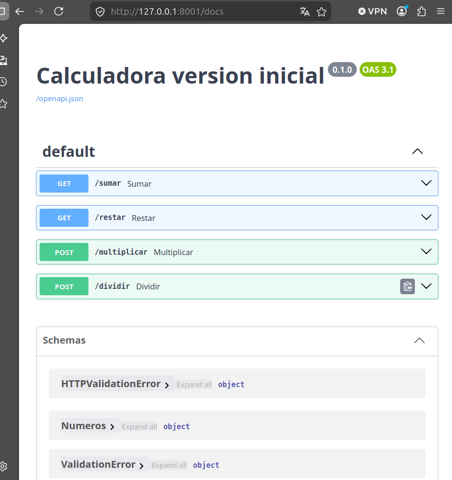

### Pruebas Paso 11.1 (Arquitectura en capas - Puerto 8000)
**1. Suma (`GET /sumar?a=8&b=2` -> `10`):**
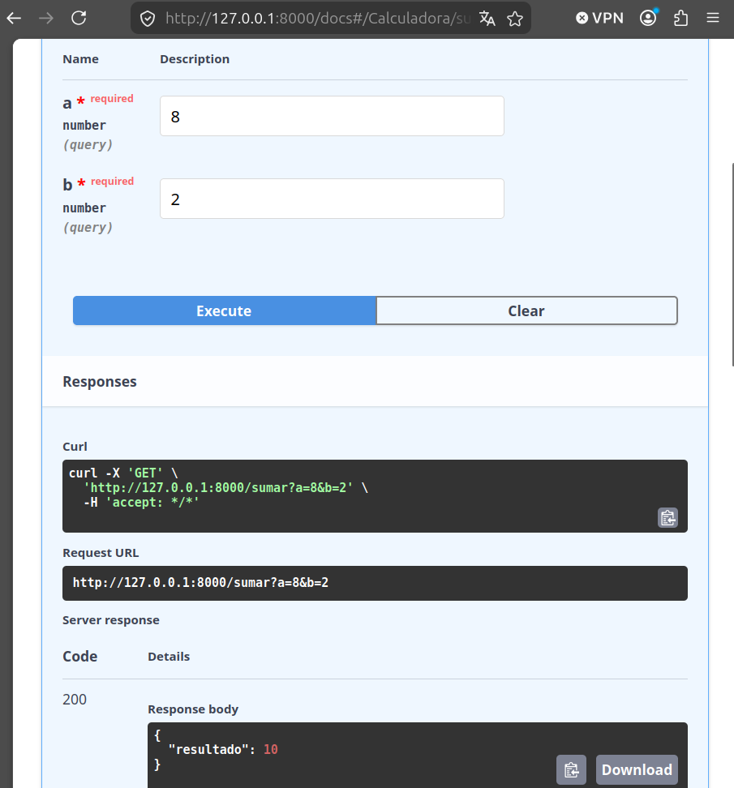

**2. Resta (`GET /restar?a=8&b=2` -> `6`):**
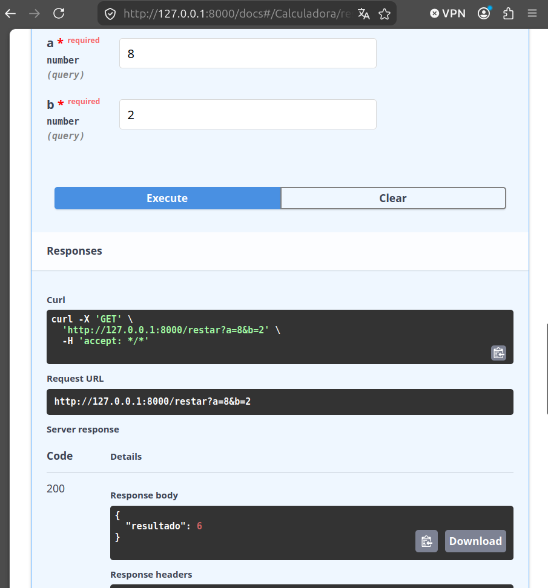

**3. Multiplicacion (`POST /multiplicar` -> `16`):**
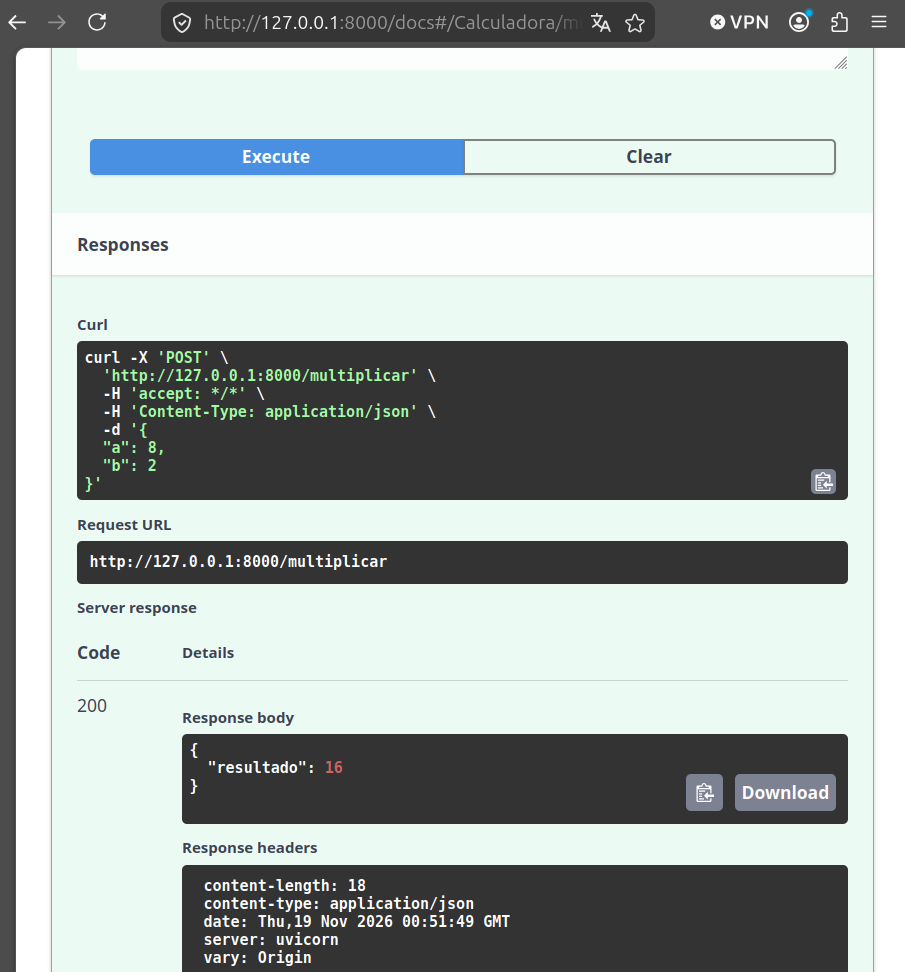

**4. Division (`POST /dividir` -> `4`):**
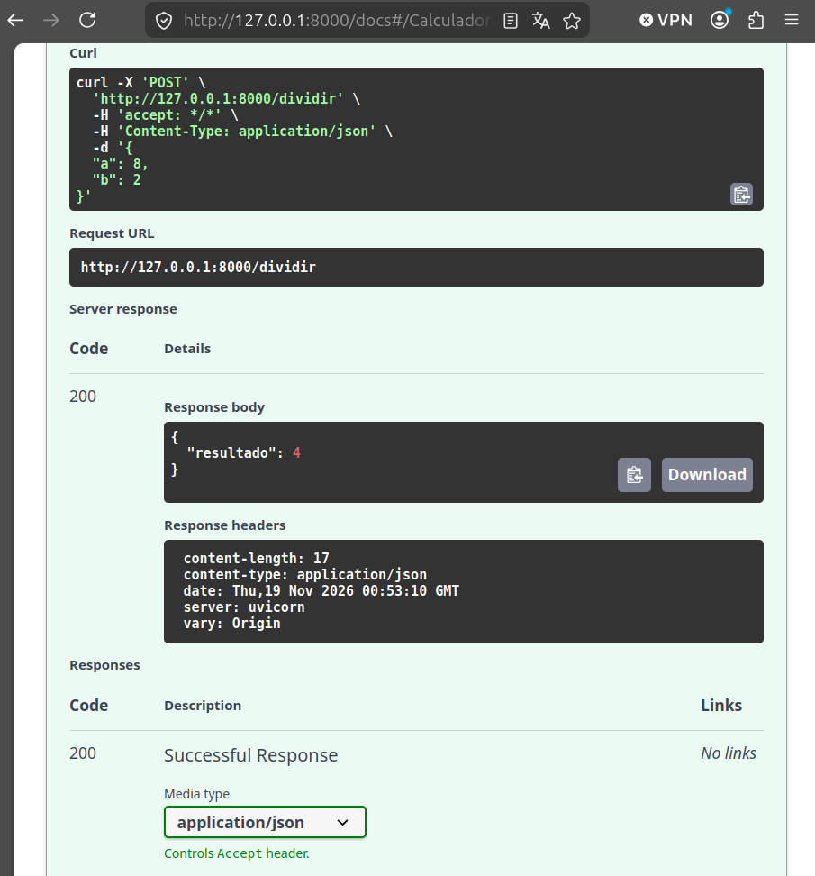

**5. Division entre cero (`POST /dividir` -> `HTTP 400`):**
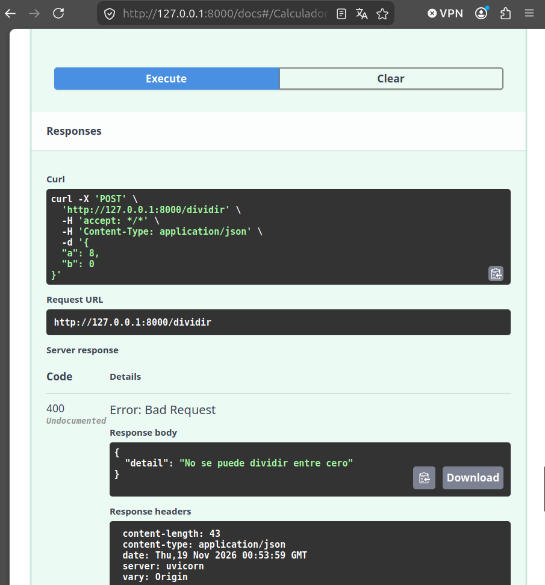

**6. Validacion de entrada incompleta (`POST /multiplicar` sin `b` -> `HTTP 422`):**
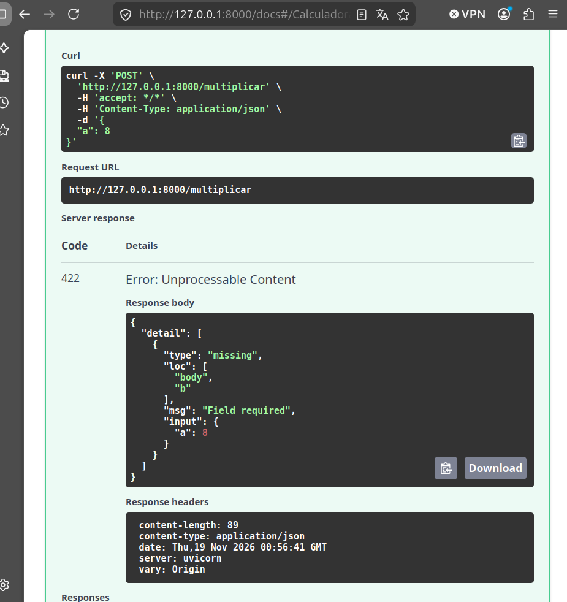
